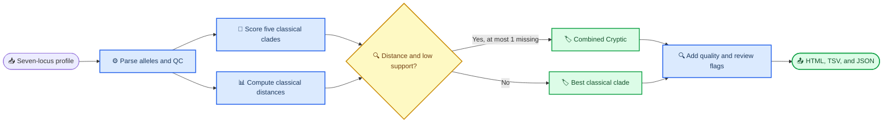

# CdiffCladeML

_A beginner-accessible, two-stage classifier for screening seven-locus
*Clostridioides difficile* MLST profiles as `Clade1`–`Clade5` or a combined
`Cryptic` category._

---

CdiffCladeML starts with seven MLST allele identifiers—not reads, genome
assemblies, or nucleotide sequences—and produces a clade-screening result,
input-quality indicators, and a clear recommendation about whether the profile
needs expert review.

The normal workflow is one command. Each run creates a human-readable HTML
report, a complete TSV table, and a JSON summary. This README explains the
workflow from first principles and then provides the model, validation, and
training details needed by advanced users.

<a id="contents"></a>

## 📍 Contents

- [Overview and key concepts](#overview)
- [Quick start](#quick-start)
- [Prepare input and run](#input-and-run)
- [Outputs and interpretation](#outputs-and-interpretation)
- [Method and model logic](#method)
- [Capabilities and validation](#capabilities-and-validation)
- [Advanced workflows and reproducibility](#advanced-workflows)
- [Troubleshooting](#troubleshooting)
- [Technical documentation and citation](#documentation)

<a id="overview"></a>

## 📋 Overview and key concepts

### What question does the tool answer?

For each supplied profile, CdiffCladeML asks:

> Does this seven-locus MLST profile resemble one of the five classical
> *C. difficile* clades, or does the combination of allele distance and weak
> classical-clade support justify a combined `Cryptic` screening call?

The answer is one of `Clade1`, `Clade2`, `Clade3`, `Clade4`, `Clade5`, or
`Cryptic`. The tool also reports whether the input is complete, whether its
alleles were represented in the model resources, and whether the result should
be reviewed manually.

### What are MLST, alleles, STs, and clades?

Multilocus sequence typing (MLST) summarizes a bacterial isolate using allele
identifiers at a fixed set of housekeeping-gene loci. In the *C. difficile*
scheme used here, those loci are `adk`, `atpA`, `dxr`, `glyA`, `recA`, `sodA`,
and `tpi`. An **allele identifier** such as `adk=1` names one known sequence
variant at one locus. The combination of the seven identifiers defines an MLST
profile and may be assigned a **sequence type**, abbreviated ST. PubMLST
maintains allele definitions and indexes unique allele combinations as STs.[^1]

A **clade** is a broad evolutionary grouping. CdiffCladeML screens profiles
against five classical clades. `Cryptic` is a sixth, combined output category
for profiles that pass the model's distance-and-support gate. It does not name
a specific cryptic lineage.

### What goes in and what comes out?

| Item | CdiffCladeML expects or produces |
| --- | --- |
| **Input** | A CSV or TSV table with one profile per row and seven allele calls |
| **Required columns** | An isolate identifier, species text, and ST text; these are retained for traceability but do not drive the prediction |
| **Prediction** | `Clade1`–`Clade5` or combined `Cryptic` |
| **Quality assessment** | Missing, approximate, and previously unseen allele counts plus a quality flag |
| **Review guidance** | Classical-stage support and `review_recommended=True/False` |
| **Routine files** | `report.html`, `predictions.tsv`, and `predictions_summary.json` |

The classifier does not call MLST alleles, assign an ST, verify the organism,
or analyze a FASTA file. Run an MLST allele-calling workflow first, then pass
its seven allele identifiers to CdiffCladeML.

<a id="quick-start"></a>

## ⚡ Quick start

You need:

| Requirement | Supported version or purpose | Check |
| --- | --- | --- |
| Python | `3.10`, `3.11`, `3.12`, or `3.13` | `python3 --version` on macOS/Linux or `py --version` on Windows |
| Git | Needed for the source-install route | `git --version` |

Python installers are available from the [official Python downloads
page](https://www.python.org/downloads/)[^2], and Git installers are available
from the [official Git downloads page](https://git-scm.com/downloads/).[^3]

### Install from the source repository

This route also gives you the bundled six-profile example used below.

On macOS or Linux:

```bash
git clone https://github.com/crodsa/ML-classifier.git
cd ML-classifier
python3 -m venv .venv
source .venv/bin/activate
python -m pip install --upgrade pip
python -m pip install .
```

On Windows PowerShell:

```powershell
git clone https://github.com/crodsa/ML-classifier.git
cd ML-classifier
py -m venv .venv
.venv\Scripts\Activate.ps1
python -m pip install --upgrade pip
python -m pip install .
```

The virtual environment keeps CdiffCladeML and its dependencies separate from
other Python software. Activate it again whenever you open a new terminal and
want to use the tool.

Verify the installation:

```bash
CdiffCladeML-predict --version
```

Expected output for this release:

```text
CdiffCladeML-predict 1.0.0
```

### Run the bundled example

From the repository directory, run:

```bash
CdiffCladeML-predict tests/data/smoke_profiles.csv
```

The command prints the three result paths and creates a directory similar to:

```text
smoke_profiles_cdiffclademl_20260815T153000Z/
├── predictions.tsv
├── predictions_summary.json
└── report.html
```

Open `report.html` by double-clicking it in your file browser. The bundled
[`smoke_profiles.csv`](tests/data/smoke_profiles.csv) contains one labelled
profile from each output category, so its six final predictions should be
`Clade1`, `Clade2`, `Clade3`, `Clade4`, `Clade5`, and `Cryptic`.

### Install a release wheel instead

If you do not need the source checkout, download
`cdiffclademl-1.0.0-py3-none-any.whl` from the
[v1.0.0 GitHub Release](https://github.com/crodsa/ML-classifier/releases/tag/v1.0.0),
create and activate a virtual environment as shown above, and install the
downloaded file:

```bash
python -m pip install /path/to/cdiffclademl-1.0.0-py3-none-any.whl
```

Replace `/path/to/` with the folder where the wheel was downloaded. The release
also contains a source archive and `SHA256SUMS` for integrity verification.

<a id="input-and-run"></a>

## 📥 Prepare input and run

### Where the allele profile comes from

The seven allele calls normally come from a separate MLST analysis of an
assembly or sequence dataset, or from a curated MLST database export.
CdiffCladeML begins after that step. Record the upstream caller version,
database or scheme snapshot, and allele-calling QC because they are not encoded
in the prediction output.

For a new, unlabelled sample, the optional `mlst_clade` column is not needed.
If you currently have only reads, an assembly, or a FASTA file, first use a
validated *C. difficile* MLST allele-calling workflow.

### Input table structure

CdiffCladeML accepts comma-separated (`.csv`) or tab-separated (`.tsv`) text.
It detects the delimiter automatically. Every nonblank row must contain exactly
10 columns for prediction or 11 columns when a known clade label is included
for evaluation.

The required order is:

```text
isolate,species,st,adk,atpA,dxr,glyA,recA,sodA,tpi[,mlst_clade]
```

| Position | Column | Meaning | Used to predict? |
| ---: | --- | --- | --- |
| 1 | `isolate` | Stable sample or isolate identifier | No |
| 2 | `species` | Species text from the upstream workflow | No |
| 3 | `st` | Sequence type or an unassigned value such as `NA` | No |
| 4–10 | `adk`–`tpi` | Seven MLST allele identifiers | Yes |
| 11 | `mlst_clade` | Optional known reference label for evaluation | No |

Only the seven allele fields drive the prediction. CdiffCladeML retains the
other columns so a result can be traced back to its input and so labelled
datasets can be evaluated by ST.

An optional header is accepted when it uses the exact names and order shown
above; matching is case-insensitive. Do not add extra metadata columns. Blank
lines are ignored.

### Minimal example

Save the following as `profiles.csv` in a spreadsheet or plain-text editor:

```csv
isolate,species,st,adk,atpA,dxr,glyA,recA,sodA,tpi
sample_001,Clostridioides difficile,29,1,1,2,16,1,3,1
sample_002,Clostridioides difficile,NA,1,5,9,37,1,1,78
```

Then run:

```bash
CdiffCladeML-predict profiles.csv
```

### Accepted allele syntax

| Input form | Interpretation | Internal status |
| --- | --- | --- |
| `1` | Exact allele identifier | `exact` |
| `adk(1)`, `adk=1`, or `adk:1` | Parenthesized or prefixed output from an upstream MLST tool | `exact` |
| `~1`, `adk(~1)`, or `adk=~1` | Approximate allele call | `approx` |
| Empty, `-`, `NA`, `N/A`, `nan`, `none`, `null`, `<NA>`, or `?` | Missing allele | `missing` |

An allele identifier that is syntactically valid but absent from the bundled
per-locus distance resources is accepted as an unknown allele. The row will be
flagged `UNKNOWN_ALLELE` and recommended for review; the identifier alone does
not contain sequence information from which a new biological distance could be
calculated.

### Choose output paths for a workflow

The one-argument command creates a new timestamped directory and never silently
overwrites an earlier run. For a pipeline that needs stable paths, use:

```bash
CdiffCladeML-predict profiles.csv \
  --output-predictions results/run_001.tsv \
  --report-html results/run_001.html
```

This produces:

```text
results/
├── run_001.tsv
├── run_001_summary.json
└── run_001.html
```

If any target already exists, the command stops rather than overwriting it.
Choose a new file name or move the previous run to an archive.

<a id="outputs-and-interpretation"></a>

## 📤 Outputs and interpretation

### Start with `report.html`

The standalone HTML report is the easiest entry point. It opens locally in a
web browser and does not require a server or upload data elsewhere. It contains:

- counts and isolate lists for each final prediction;
- counts for input-quality flags and classical-stage support bands;
- a complete `Detailed calls — all input profiles` table with decision fields
  first and a `★` marker in `review_recommended` for profiles requiring expert
  review;
- evaluation metrics when known `mlst_clade` labels were supplied; and
- the software version, model version, and model SHA-256.

The HTML report is a review aid alongside the complete machine-readable
`predictions.tsv`.

### Read one result safely

Use these fields in this order:

| Step | Field | Question to ask |
| ---: | --- | --- |
| 1 | `quality_flag` | Was the seven-locus input complete and represented in the model resources? |
| 2 | `final_prediction` | Which classical clade or combined Cryptic category was called? |
| 3 | `review_recommended` | Does the tool explicitly require manual review? |
| 4 | `stage1_support_band` | How strongly did the classical Random Forest support its best classical clade? |
| 5 | `final_reason` | Did the final call come from the classical stage or the Cryptic gate? |

Do not interpret `final_prediction` without the quality and review fields.

### Final predictions and reasons

| Output | Meaning | Recommended interpretation |
| --- | --- | --- |
| `Clade1`–`Clade5` | The Cryptic gate was not activated; the best classical-stage clade is reported | Use with its quality flag and support band; review consequential or unusual findings |
| `Cryptic` | Distance from classical alleles/profiles and weak classical-stage support met the gate | Treat as a combined screening category; confirm with allele QC and phylogenomic analysis when the distinction matters |
| `classical_stage1` | Value of `final_reason` for a classical call | The final label is the Stage-1 Random Forest result |
| `distance+low_classical_support` | Value of `final_reason` for a Cryptic call | Both the distance and low-classical-support parts of the gate were satisfied |

`Cryptic` does not distinguish individual cryptic lineages. The model was not
designed to make that assignment.

### Input-quality flags

The flags have a precedence order, so each row receives one value:

| `quality_flag` | Rule | What to do |
| --- | --- | --- |
| `PASS` | No missing, approximate, or unknown alleles | Continue to the prediction and review fields; `PASS` is not proof that the clade call is correct |
| `PARTIAL_PROFILE` | One missing allele or at least one approximate allele, with no unknown allele | Confirm the MLST call; interpret support and distances cautiously |
| `UNKNOWN_ALLELE` | At least one nonmissing allele identifier is absent from the model's distance resources, with no higher-priority insufficient-loci flag | Verify the identifier and inspect its sequence/phylogenetic context outside this tool |
| `INSUFFICIENT_LOCI` | More than one of the seven loci is missing | Do not rely on the emitted clade as a robust classification; recover or repeat the missing allele calls |

The predictor still emits a row when loci are missing. In particular, the
Cryptic gate cannot activate when more than one locus is missing, so a
classical-looking label on an `INSUFFICIENT_LOCI` row must not be treated as a
reliable exclusion of a cryptic profile.

### Classical-stage support bands

`stage1_confidence` is the largest Random Forest class probability for the five
classical clades. The human-readable band is assigned as follows:

| `stage1_support_band` | Rule |
| --- | ---: |
| `HIGH` | `stage1_confidence >= 0.80` |
| `MEDIUM` | `0.55 <= stage1_confidence < 0.80` |
| `LOW` | `stage1_confidence < 0.55` |

These values describe Stage 1 only. They are not calibrated probabilities that
the final classical-or-Cryptic answer is correct. `confidence_band` is retained
as a compatibility alias of `stage1_support_band`.

### Why a row is recommended for review

`review_recommended=True` when any of the following is true:

- `stage1_support_band` is `LOW`;
- `quality_flag` is not `PASS`; or
- the final prediction is `Cryptic` and `rare_locus_count_report` is below
  four.

The four-rare-locus check is a review rule, not a hard condition of the Cryptic
gate. Conversely, `review_recommended=False` means that none of these automatic
triggers fired; it does not replace scientific review when a result is
consequential.

### `predictions.tsv`: complete row-level results

TSV means tab-separated values. Open the file in a spreadsheet for inspection
or parse it with R, Python, or another workflow tool. It contains one output row
for every input row.

<details>
<summary><strong>📊 Complete prediction-column guide</strong></summary>

#### Copied input columns

| Column or pattern | Meaning |
| --- | --- |
| `isolate`, `species`, `st` | Input metadata retained after surrounding whitespace is removed |
| `adk`, `atpA`, `dxr`, `glyA`, `recA`, `sodA`, `tpi` | Original allele cells retained after surrounding whitespace is removed |
| `mlst_clade` | Optional supplied reference label; absent from unlabelled input |

#### Parsed allele columns

Each of the seven loci has three derived columns:

| Pattern | Example | Meaning |
| --- | --- | --- |
| `<locus>_base` | `adk_base` | Parsed allele identifier, or `__MISSING__` |
| `<locus>_status` | `adk_status` | `exact`, `approx`, or `missing` |
| `<locus>_token` | `adk_token` | Model token: `E:<allele>`, `A:<allele>`, or `__MISSING__` |

#### Classical-stage and distance features

| Column | Meaning |
| --- | --- |
| `stage1_predicted_clade` | Best Stage-1 call among `Clade1`–`Clade5` |
| `stage1_confidence` | Largest Stage-1 class probability |
| `stage1_margin` | Difference between the largest and second-largest Stage-1 class probabilities |
| `stage1_entropy` | Shannon entropy of the five Stage-1 class probabilities; larger values indicate a more diffuse distribution |
| `sum_min_dist_any_classical` | Sum across loci of each allele's minimum model distance to any classical training allele |
| `nearest_profile_dist_any_classical` | Minimum summed distance to any unique classical training profile |
| `n_missing_loci` | Number of missing allele calls |
| `n_approx_loci` | Number of approximate allele calls |
| `n_unknown_alleles` | Number of nonmissing identifiers absent from the model's per-locus distance resources |
| `rare_locus_count_report` | Number of loci whose minimum distance to classical alleles is greater than zero; this is a model-specific review feature, not a universal definition of allele rarity |

#### Final and review columns

| Column | Meaning |
| --- | --- |
| `cryptic_distance_call` | `1` when the Stage-2 Cryptic gate activates; otherwise `0` |
| `final_prediction` | `Clade1`–`Clade5` or combined `Cryptic` |
| `final_reason` | `classical_stage1` or `distance+low_classical_support` |
| `stage1_support_band` | `HIGH`, `MEDIUM`, or `LOW` from Stage-1 support |
| `confidence_band` | Compatibility alias of `stage1_support_band` |
| `quality_flag` | `PASS`, `PARTIAL_PROFILE`, `UNKNOWN_ALLELE`, or `INSUFFICIENT_LOCI` |
| `review_recommended` | Boolean review trigger derived from support, quality, and the Cryptic review rule |

</details>

---

### `predictions_summary.json`: run-level metadata

JSON is a structured text format intended for automation and provenance. The
summary contains:

| Key | Contents |
| --- | --- |
| `tool`, `version` | Software identity and package version |
| `model_version`, `model_sha256` | Bundled or selected model provenance |
| `runtime` | Python and scikit-learn versions used for the run |
| `predicted_at` | UTC run timestamp |
| `n_samples` | Number of processed profiles |
| `class_counts` | Final-prediction counts |
| `stage1_support_bands` | `HIGH`/`MEDIUM`/`LOW` counts |
| `quality_flags` | Counts for each observed quality flag |
| `n_review_recommended` | Number of rows requiring review |
| `n_cryptic_gate`, `cryptic_rate_pct` | Number and percentage activating the Cryptic gate |
| `output_paths` | Absolute paths to the TSV, JSON, and HTML artifacts |

The JSON does not contain every row. Use `predictions.tsv` for row-level data.

<a id="method"></a>

## ⚙️ Method and model logic

### Two-stage decision process



### Stage 1: classical-clade Random Forest

Stage 1 is trained only on the five classical clades. For each locus, the
parser distinguishes exact (`E:`), approximate (`A:`), and missing allele
tokens. A one-hot encoder converts those categorical tokens into model inputs;
previously unseen tokens are ignored by the encoder rather than causing a
runtime failure.

The bundled Stage-1 estimator is a scikit-learn Random Forest with:

- 500 trees;
- `class_weight="balanced_subsample"`;
- `random_state=42`; and
- all available CPU cores during the final fit.

It returns the best classical clade, the largest class probability, the margin
between the top two classes, and the entropy of the five-class distribution.

### Stage 2: combined Cryptic gate

Stage 2 compares each query with classical alleles and unique classical MLST
profiles stored in the model bundle. The gate activates only when all three
parts are true:

```text
(allele-distance signal OR profile-distance signal)
AND
(low Stage-1 confidence OR low Stage-1 margin)
AND
(no more than one missing locus)
```

If the gate activates, `final_prediction` becomes `Cryptic`. Otherwise, the
Stage-1 classical clade is retained.

<details>
<summary><strong>🔧 Exact bundled thresholds and distance fallbacks</strong></summary>

The bundled `model.joblib` (`v1.0.0`) records these learned gate values:

| Rule | Threshold |
| --- | ---: |
| `sum_min_dist_any_classical` | `>= 0.06288377553666645` |
| `nearest_profile_dist_any_classical` | `>= 0.005564496727467278` |
| `stage1_confidence` | `<= 0.44551020408163255` |
| `stage1_margin` | `<= 0.010000000000000009` |
| `n_missing_loci` | `<= 1` |

The first two rules are joined by `OR`; the next two are joined by `OR`; the
three rule groups are joined by `AND`.

Distances are model-specific values from the bundled per-locus resources. For
a missing allele or an allele pair absent from a distance matrix, the feature
code uses that locus's 95th percentile of positive distances as a fallback. An
approximate call adds `0.25` times the locus's mean positive distance. These
fallbacks make a numeric prediction possible but do not infer the unknown
allele's nucleotide sequence or evolutionary placement.

The exact rules, training hashes, distance-resource hashes, architecture, and
benchmark metadata are recorded in
[`model_model_card.json`](model_model_card.json).

</details>

---

### Model integrity and compatibility

Before loading a model, the predictor computes its SHA-256 and compares it with
the adjacent model card when a digest is recorded. A mismatch stops execution.
The official model was serialized with scikit-learn `1.7.1`, so the package
pins that exact version and rejects cross-version loading by default.

Joblib model files use Python pickle internally and can execute code while
loading. Only use the official bundled model or a model from a source you trust;
see the [security policy](SECURITY.md).

<a id="capabilities-and-validation"></a>

## 📊 Capabilities and validation

### Appropriate uses

CdiffCladeML can support:

- reproducible screening of one or many *C. difficile* seven-locus profiles;
- prioritization of unusual, incomplete, or cryptic-like profiles for review;
- standardized cohort summaries with machine-readable provenance;
- comparison with known labels in a curated evaluation table; and
- method development with a replacement, locally validated model bundle.

### What it does not establish

The output does not by itself establish:

- an MLST allele or ST from raw sequence data;
- organism identity or sample purity;
- a specific cryptic lineage;
- a whole-genome phylogeny, transmission link, or evolutionary event;
- a calibrated probability that the final call is correct; or
- a clinical diagnosis, prognosis, or treatment decision.

When a result has biological, epidemiological, or clinical consequences,
confirm input allele calls and use sequence-based or phylogenomic analysis
appropriate to the question.

### Bundled model and held-out benchmark

The software and bundled model release is `1.0.0` (`v1.0.0`). The training collection contained 25,124 isolates representing
130 STs: 25,020 classical isolates and 104 isolates labelled `Cryptic`. ST
diversity comprised 18 Clade1 STs, six STs in each of Clade2–Clade5,
and 88 Cryptic STs.

The held-out benchmark contained 4,650 isolates representing 319 STs, with zero
training/test overlap by isolate, ST, or complete seven-locus profile.

Aggregate results were:

| Evaluation unit | Accuracy | Balanced accuracy | Macro F1 | Weighted F1 |
| --- | ---: | ---: | ---: | ---: |
| One vote per ST (`n=319`) | `0.9373` | `0.9416` | `0.9527` | `0.9346` |
| Isolate weighted (`n=4,650`) | `0.9695` | `0.9161` | `0.9353` | `0.9663` |

Per-ST recall shows where the evidence is strong or limited:

| True category | STs | Correct | Recall | 95% Wilson CI |
| --- | ---: | ---: | ---: | ---: |
| `Clade1` | 179 | 176 | `0.9832` | `0.9519–0.9943` |
| `Clade2` | 59 | 43 | `0.7288` | `0.6040–0.8256` |
| `Clade3` | 3 | 3 | `1.0000` | `0.4385–1.0000` |
| `Clade4` | 37 | 37 | `1.0000` | `0.9059–1.0000` |
| `Clade5` | 16 | 15 | `0.9375` | `0.7167–0.9889` |
| `Cryptic` | 25 | 25 | `1.0000` | `0.8668–1.0000` |

Important interpretation points are:

- Clade2 recall was lower than for the other reported categories;
- Clade3 had only three benchmark STs, so its perfect observed recall is not a
  stable performance estimate;
- repeated isolates within STs are not independent observations;
- residual phylogenetic dependence can make even ST-level intervals
  optimistic; and
- Random Forest class probabilities were not calibrated as final-call
  probabilities.

See [Validation and methodology summary](docs/VALIDATION.md) for the confusion
matrix, cross-validation methodology, distance-resource QC, and scope boundaries.

<a id="advanced-workflows"></a>

## 🔧 Advanced workflows and reproducibility

### Prediction command reference

```text
CdiffCladeML-predict INPUT_TABLE [OPTIONS]
```

| Argument | Purpose |
| --- | --- |
| `INPUT_TABLE` | Required 10- or 11-column CSV/TSV profile table |
| `-o PATH`, `--output-predictions PATH` | Choose the prediction TSV path instead of an automatic run directory |
| `--report-html PATH` | Choose the HTML report path |
| `--metrics_prefix PREFIX` | With supplied `mlst_clade` labels, write isolate- and ST-weighted evaluation files |
| `--model MODEL.joblib` | Use a trusted replacement model and adjacent model card |
| `--verbose` | Print progress information |
| `--version` | Print the software version |
| `--allow-version-mismatch` | Expert-only compatibility diagnostic; bypasses the default scikit-learn version rejection |

Run `CdiffCladeML-predict --help` for the installed command reference. The
short alias `cdiff-predict` invokes the same entry point.

### Evaluate a labelled table

Add an eleventh `mlst_clade` column containing `Clade1`, `Clade2`, `Clade3`,
`Clade4`, `Clade5`, `Cryptic`, or a recognized missing value. Parenthesized or
numeric FastMLST output such as `mlst_clade(Clade1)`, `mlst_clade(1.0)`, or
`mlst_clade(cryptic)` is also normalized automatically. Then run:

```bash
CdiffCladeML-predict labelled_profiles.tsv \
  --output-predictions evaluation/predictions.tsv \
  --metrics_prefix evaluation/metrics
```

The prefix creates four isolate-weighted files and four corresponding
one-vote-per-ST files:

```text
evaluation/
├── metrics_summary.tsv
├── metrics_per_class.tsv
├── metrics_confusion.tsv
├── metrics_classification_report.json
├── metrics_by_st_summary.tsv
├── metrics_by_st_per_class.tsv
├── metrics_by_st_confusion.tsv
└── metrics_by_st_classification_report.json
```

Rows whose ST is missing or marked `new_ST`, `novel_ST`, or `new_alleles` are
treated as separate unassigned groups rather than being incorrectly collapsed
into one ST.

### Use a replacement model

Keep a trusted model and its card together with matching stems:

```text
my_model.joblib
my_model_model_card.json
```

Run:

```bash
CdiffCladeML-predict profiles.tsv --model my_model.joblib
```

The predictor checks the card's model hash, serialization version, bundle
schema, classical model classes, distance rules, per-locus stores, and
classical reference profiles before prediction. A missing card causes a
warning; a recorded hash mismatch stops the run.

### Train a new model

Training is an expert workflow and does not automatically validate a model for
deployment. It requires:

- an 11-column table with a valid `mlst_clade` label on every row;
- all six categories represented;
- enough label-consistent ST groups for five-fold grouped cross-validation;
- no duplicated isolate identifiers or contradictory profile/ST labels; and
- seven distance TSVs named `adk.tsv`, `atpA.tsv`, `dxr.tsv`, `glyA.tsv`,
  `recA.tsv`, `sodA.tsv`, and `tpi.tsv`, each with `allele_1`, `allele_2`, and
  `distance` columns.

Example:

```bash
CdiffCladeML-train training_profiles.tsv \
  --distance_dir distance_matrices \
  --output_model models/new_model.joblib \
  --metrics_prefix training_metrics/oof \
  --min_cryptic_recall 0.90 \
  --threshold_grid_size 25 \
  --n_jobs 1 \
  --verbose
```

The trainer uses five ST-grouped folds, reconstructs classical allele
references within each fold, cross-fits the Cryptic gate for a reduced-bias OOF
diagnostic, fits deployment rules using all OOF features, then trains the final
classical model on all classical rows. It writes the joblib bundle and an
adjacent JSON model card with input hashes, distance-resource hashes, rules,
software versions, metrics, and runtime.

With `--metrics_prefix training_metrics/oof`, the complete training artifact
set is:

```text
models/
├── new_model.joblib
└── new_model_model_card.json
training_metrics/
├── oof_oof_meta.tsv
├── oof_summary.tsv
├── oof_per_class.tsv
├── oof_confusion.tsv
├── oof_classification_report.json
├── oof_by_st_summary.tsv
├── oof_by_st_per_class.tsv
├── oof_by_st_confusion.tsv
├── oof_by_st_classification_report.json
└── oof_training_summary.json
```

The cross-fitted OOF results are a training diagnostic, not a substitute for a
new external or locked validation cohort.

`--n_jobs` controls parallel CV folds and is capped at five useful workers. Use
one worker on memory-constrained systems. Lowering `--min_cryptic_recall` or
replacing thresholds requires a documented scientific rationale and a new
locked-cohort evaluation.

Run `CdiffCladeML-train --help` for all training options. The short alias
`cdiff-train` invokes the same entry point.

### Preserve a reproducible run

Archive the following together:

- the unchanged input table and its checksum;
- the exact command or workflow configuration;
- all three routine output files;
- `CdiffCladeML-predict --version` output;
- `model_version` and `model_sha256` from the summary JSON; and
- Python and scikit-learn versions from the summary JSON.

Automatic result directories include a UTC timestamp, explicit paths never
overwrite existing artifacts, and the JSON summary records absolute output
paths. Official release assets include a checksum file. These controls make a
run reconstructable but do not replace documentation of the upstream MLST
caller, database snapshot, allele-calling criteria, or sample QC.

<a id="troubleshooting"></a>

## 🔍 Troubleshooting

### `Every row ... must have 10 or 11 columns`

**Cause:** A delimiter, header, extra metadata column, embedded comma, or blank
cell was exported incorrectly.

**Fix:** Re-export as CSV or TSV, retain exactly the documented columns in
order, and quote text containing delimiter characters. A header is optional,
but if present it must use the documented names.

### `Unknown mlst_clade label(s)`

**Cause:** An optional reference label does not exactly match `Clade1`–`Clade5`
or `Cryptic`.

**Fix:** Correct the label or replace it with a recognized missing value. Do
not use individual cryptic-lineage names in this combined label field.

### A result has `UNKNOWN_ALLELE`

This is a successful run with an input warning, not a parser failure. Confirm
that the allele identifier is correct. Because the table contains an identifier
rather than sequence, CdiffCladeML uses a conservative model fallback and
recommends external sequence-aware review.

### `Model requires scikit-learn 1.7.1`

**Cause:** The active environment has a different scikit-learn version from
the serialized model.

**Fix:** Create a clean environment and reinstall the supported package:

```bash
python -m pip install --force-reinstall .
```

Do not use `--allow-version-mismatch` for routine analysis. It is intended only
for expert migration diagnostics followed by a full regression test.

### `Model integrity check failed`

**Cause:** The joblib SHA-256 does not match the adjacent model card.

**Fix:** Stop. Reacquire both files from the same trusted release or training
run. Do not edit the digest to make the error disappear.

## 🔗 Technical documentation and citation

### Documentation map

| Document | What it answers |
| --- | --- |
| [Validation and methodology summary](docs/VALIDATION.md) | Benchmark performance, ST-grouped cross-validation design, and interpretation scope |
| [Adapting to other MLST schemes](docs/ADAPTING_TO_OTHER_MLST_SCHEMES.md) | What is reusable vs *C. difficile*-specific and how to build a separately validated derivative classifier |
| [Model provenance](docs/MODEL_PROVENANCE.md) | Where the distributed model and distance resources came from and what is redistributed |
| [Bundled model card](model_model_card.json) | Exact architecture, hashes, rules, cohort sizes, metrics, and limitations |
| [Security policy](SECURITY.md) | Why joblib files must be trusted and how hash/version checks work |
| [Changelog](CHANGELOG.md) | Release notes for v1.0.0 |
| [Contributing guide](CONTRIBUTING.md) | How to propose code, documentation, or model changes |
| [Citation metadata](CITATION.cff) | The software citation record |
| [MIT licence](LICENSE) | Terms for using and redistributing the source and bundled artifacts |

### Citation

If you use CdiffCladeML, cite the software using [`CITATION.cff`](CITATION.cff)
and cite the accompanying *Microbial Genomics* article.

### Licence

The source code and bundled model resources (`model.joblib` and `model_model_card.json`) are distributed under the [MIT Licence](LICENSE).

---

[^1]: PubMLST. “Clostridioides difficile.” The typing database defines allele identifiers and MLST profiles/STs. Accessed 2026-08-15. https://pubmlst.org/organisms/clostridioides-difficile

[^2]: Python Software Foundation. “Download Python.” Accessed 2026-08-15. https://www.python.org/downloads/

[^3]: Git project. “Downloads.” Accessed 2026-08-15. https://git-scm.com/downloads/
